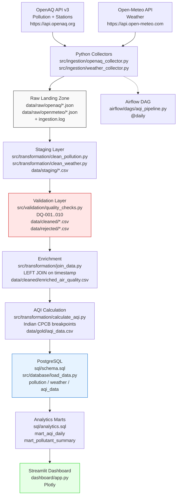

# Architecture Diagram — Air Quality Index Analysis

## 1. High-Level Architecture



## 2. Layered Data Architecture (Medallion)

| Layer | Location | Description | Requirement |
|---|---|---|---|
| **Source** | OpenAQ, Open-Meteo | Free public REST APIs. Bengaluru 12.9716,77.5946 radius 25km | `assignment.md:19` |
| **Ingestion** | `src/ingestion/` | `requests` + `python-dotenv`, timestamped JSON, handles pagination, API key via `OPENAQ_API_KEY` | Scheduled via Airflow |
| **Raw** | `data/raw/openaq/` `data/raw/openmeteo/` | Immutable landing, original API response + metadata (extraction_date, source, status, row_count) in `logs/ingestion.log` | `assignment.md:41` |
| **Staging** | `data/staging/` | Normalized timestamps (UTC), pollutant names lowercased, units kept as µg/m³, deduped | `clean_pollution.py` `clean_weather.py` |
| **Cleaned + Validation** | `data/cleaned/` `data/rejected/` | DQ checks `validation_rules.md`, rejected records with `error_reason`, duplicates removed | `quality_checks.py` |
| **Enriched** | `data/cleaned/enriched_air_quality.csv` | LEFT JOIN pollution ↔ weather on hourly `timestamp` (weather IST→UTC) | `join_data.py` |
| **Gold** | `data/gold/aqi_data.csv` | AQI per `station_id+timestamp` = max sub-index via CPCB breakpoints + category (Good..Severe) | `calculate_aqi.py` |
| **Storage** | PostgreSQL `air_quality_db` | `pollution`, `weather`, `aqi_data` tables `schema.sql` | `load_data.py` |
| **Analytics** | PostgreSQL marts | `mart_aqi_daily` (avg/max/min per date), `mart_pollutant_summary` (avg/max/min per pollutant) | `analytics.sql` |
| **Visualization** | Streamlit | 6 views: Trend, Category, By Station, Distribution, Pollutant, Weather Impact | `dashboard/app.py` |

## 3. Pipeline Flow (Airflow DAG `aqi_pipeline.py`)

```
collect_openaq ─┐
                ├─→ clean_pollution ─┐
collect_weather─┘   clean_weather ────┼─→ quality_checks → join_data → calculate_aqi → (load_data → run_analytics outside DAG)
```

* `start_date=2026-09-01`, `schedule=@daily`, `catchup=False`
* Each task is `BashOperator` calling `python src/...` for reproducibility outside Airflow.

## 4. Data Quality & Monitoring

* Validation rules `docs/validation_rules.md:5` DQ-001..010 enforced in `quality_checks.py`.
* Rejected records stored in `data/rejected/` with `error_reason` column.
* Ingestion log `logs/ingestion.log` records `timestamp | source | status | rows | file`.
* No manual edits to `data/gold/` — regenerated via `calculate_aqi.py`.

## 5. Technology Stack

Python, Pandas, Requests, SQLAlchemy + psycopg2, PostgreSQL, Apache Airflow, Streamlit, Plotly.

## 6. Part 2 Extension (Not yet implemented)

Same gold layer feeds MLflow feature pipeline (lag/rolling), FastAPI + Docker, monitoring for drift.

## 7. Setup Evidence

See `README.md` for `pip install -r requirements.txt`, `.env` config, `python src/...` sequential run and `streamlit run dashboard/app.py`.
